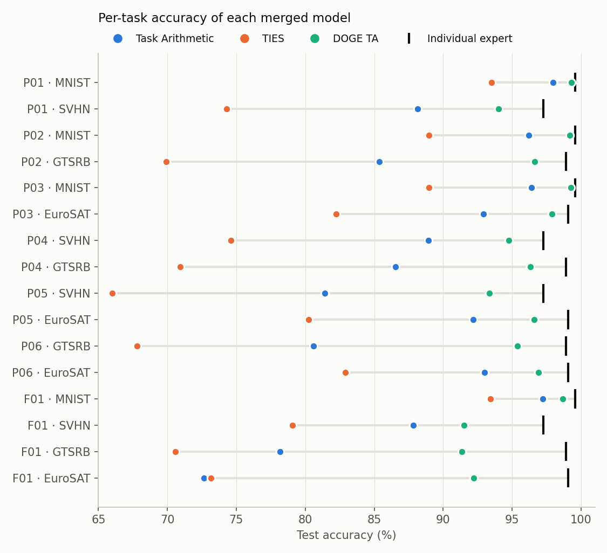

# Data-Free Multi-Task Model Merging with DOGE

[](https://www.python.org/downloads/release/python-3100/)
[](https://pytorch.org/)

An empirical evaluation of **DOGE** (*Modeling Multi-Task Model Merging as Adaptive Projective
Gradient Descent*, Wei et al., ICML 2025) against **Task Arithmetic** and **TIES-Merging** on
**CLIP ViT-B/32** experts for four image-classification tasks: MNIST, SVHN, GTSRB and EuroSAT.

Neural Networks course exam project. It answers three questions agreed with the course professor:

| | Question |
|---|---|
| **RQ1** | Does DOGE preserve more task performance than Task Arithmetic and TIES-Merging? |
| **RQ2** | How does each method change when merging **four** models instead of **two**? |
| **RQ3** | Are pairs of models with more **similar task vectors** easier to merge? |

All 21 merges (6 pairs + 1 four-task merge, × 3 methods) were run on one NVIDIA RTX 4090. Every
number in this repository is **measured**, stored as a raw JSON record in [`results/raw/`](results/raw),
and every table, figure and the notebook are regenerated from those records by code.

> **To reproduce the results:** Follow [INSTRUCTION.md](INSTRUCTION.md), or start with
> [Quick start](#quick-start) below.

The repository includes source code, configurations, raw and processed results, figures, and
the executed notebook. The `tests/` directory is retained locally and excluded from GitHub. Slides and speaker notes are not included. Downloaded models,
datasets, the official DOGE checkout, and the Python environment are created during setup or
experiment runs; they are not required to read the submitted results.

---

## Table of contents

- [Key results](#key-results)
- [Quick start](#quick-start)
- [Repository layout](#repository-layout)
- [Method and experimental setup](#method-and-experimental-setup)
- [Reproducibility and research integrity](#reproducibility-and-research-integrity)
- [Limitations](#limitations)
- [Documentation](#documentation)
- [Citation](#citation)
- [Acknowledgements and licences](#acknowledgements-and-licences)

---

## Key results

Mean test accuracy (%) over the merged tasks, and mean normalized retention (%) = 100 × merged
accuracy ÷ individual-expert accuracy
([`main_table`](results/processed/analysis__20261018T222449Z/main_table.md)):

| Merge | Tasks | Task Arithmetic | TIES | **DOGE TA** |
|---|---|---|---|---|
| P01 | MNIST + SVHN | 93.06 / 94.51 | 83.91 / 85.15 | **96.67 / 98.19** |
| P02 | MNIST + GTSRB | 90.78 / 91.46 | 79.44 / 80.01 | **97.91 / 98.65** |
| P03 | MNIST + EuroSAT | 94.67 / 95.31 | 85.61 / 86.18 | **98.56 / 99.23** |
| P04 | SVHN + GTSRB | 87.73 / 89.46 | 72.77 / 74.21 | **95.54 / 97.40** |
| P05 | SVHN + EuroSAT | 86.81 / 88.38 | 73.14 / 74.44 | **94.97 / 96.74** |
| P06 | GTSRB + EuroSAT | 86.79 / 87.67 | 75.35 / 76.11 | **96.16 / 97.14** |
| F01 | all four | 83.97 / 85.08 | 79.06 / 80.08 | **93.44 / 94.66** |

<p align="center">
  
</p>

**Findings**

- **RQ1.** DOGE TA has the highest mean accuracy *and* the highest worst-task accuracy in all
  7 merges: +3.60 to +9.47 points over Task Arithmetic and +12.76 to +22.77 over TIES.
- **RQ2.** From two to four models, mean retention falls by 6.05 points for Task Arithmetic
  (EuroSAT −20.22) and 3.24 for DOGE; TIES rises by 0.73
  ([`two_vs_four`](results/processed/analysis__20261018T222449Z/two_vs_four.md)).
- **RQ3.** Task-vector cosine similarity (0.013–0.154) does not order the pairs by retention:
  Spearman's ρ = +0.03 (TA), −0.20 (TIES), −0.03 (DOGE), n = 6. The three pairs containing MNIST
  retain best under every method.

Hypothesis verdicts, discrepancies with the paper and limitations are in
[docs/ANALYSIS_NOTES.md](docs/ANALYSIS_NOTES.md); the executed walkthrough is
[notebooks/doge_merging_exam.ipynb](notebooks/doge_merging_exam.ipynb).

---

## Quick start

Requirements: macOS on Apple Silicon or Linux (Windows through WSL2), `git`, and
[`uv`](https://docs.astral.sh/uv/). No GPU is needed to install, test and re-analyse.

Extract the submission archive, then open a terminal in the directory containing the extracted
`exam-project` folder:

```bash
cd exam-project
bash scripts/setup_env.sh      # Python 3.10 venv and official DOGE code at a pinned commit
source .venv/bin/activate
```

Then regenerate every table and figure, and the notebook, from the shipped raw results:

```bash
python scripts/check_results.py   # validates all 21 merge records
python scripts/analyze.py         # tables -> results/processed/, figures -> figures/
uv pip install -r requirements-notebook.txt && python scripts/build_notebook.py
```

Re-running the experiments themselves needs a CUDA GPU and 30–45 minutes; see
[INSTRUCTION.md §6](INSTRUCTION.md#6-re-run-the-experiments-gpu).

### Clean-environment check

To verify the setup independently of an existing `.venv`, choose an unused environment directory
and run from the project root:

```bash
bash scripts/setup_env.sh /tmp/doge-exam-clean
if [ -d tests ]; then /tmp/doge-exam-clean/bin/python -m pytest -q; fi
```

The setup creates a new environment manifest in `results/manifests/`; preserve the shipped
manifest files when cleaning up local verification output.

---

## Repository layout

```
exam-project/
├── README.md                  this file
├── INSTRUCTION.md             step-by-step install, test and reproduction guide
├── CITATION.cff               how to cite this repository
├── pyproject.toml             package metadata (doge_exam, Python 3.10)
├── requirements.txt           pinned dependencies (Linux / CUDA)
├── requirements.lock          fully resolved dependencies (macOS arm64)
├── requirements-notebook.txt  extra pins to build and execute the notebook
├── configs/
│   ├── canonical_methods.yaml method settings, frozen before any result (canonical-v1)
│   ├── experiments.yaml       experiment matrix P01–P06, F01 and evaluation settings
│   ├── pins.yaml              exact checkpoint revisions and test-set fingerprints
│   ├── paper_reference.yaml   paper-reported values, used only as a sanity check
│   └── paths.yaml             storage roots (overridable by environment variables)
├── src/doge_exam/             project package
│   ├── runner.py              builds FusionBench model pool, method and task pool; saves records
│   ├── probes.py              data-access probe and DOGE optimisation probe
│   ├── analysis.py            two-vs-four, similarity-vs-retention, hypothesis rules
│   ├── similarity.py          task-vector cosine similarity (encw-cos)
│   ├── metrics.py             accuracy, retention, interference gap
│   ├── inventory.py           checkpoint integrity checks
│   └── paths.py, device.py, env_info.py
├── scripts/
│   ├── setup_env.sh           create the environment and run environment tests
│   ├── verify_inventory.py    checkpoint and dataset verification
│   ├── run_experiment.py      reference evaluations, merges, determinism check
│   ├── compute_similarity.py  six-pair task-vector similarity
│   ├── check_results.py       schema and validity checks on every merge record
│   ├── analyze.py             all tables and figures from results/raw
│   ├── make_table.py          quick comparison table
│   ├── compare_results.py     compare a re-run with the shipped results
│   ├── verify_provenance.py   check records against this checkout's config and code hashes
│   ├── build_notebook.py      build and execute the notebook
│   └── record_env.py          write an environment record
├── notebooks/doge_merging_exam.ipynb   executed analysis notebook
├── results/
│   ├── raw/                   one immutable JSON record per run (the measured data)
│   ├── manifests/             environment, checkpoint inventory, determinism, reproduction records
│   └── processed/             tables generated by scripts/analyze.py
├── figures/                   figures generated by scripts/analyze.py
└── docs/
    ├── EXPERIMENT_PROTOCOL.md research questions, design, test plan, result contract
    ├── PAPER_TO_CODE_MAP.md   Algorithm 1 mapped to the official code; discrepancies D1–D7
    └── ANALYSIS_NOTES.md      findings, hypotheses, discrepancies, limitations
```

Not in the repository, created on demand: `.venv/`, `third_party/DOGE/` (official code, cloned by
`setup_env.sh`), and `cache/` (Hugging Face checkpoints and datasets, about 7 GB, only for re-running
experiments).

---

## Method and experimental setup

**Models.** Pretrained `openai/clip-vit-base-patch32` and four experts fine-tuned by FusionBench
(`tanganke/clip-vit-base-patch32_{mnist,svhn,gtsrb,eurosat}`), at the revisions in
[`configs/pins.yaml`](configs/pins.yaml). A task vector is τᵢ = θᵢ − θ₀.

**Methods.** The official implementations from the DOGE repository (a FusionBench 0.2.11 fork,
commit `ca0a0a1`), with one setting each, fixed in
[`configs/canonical_methods.yaml`](configs/canonical_methods.yaml) before any result was seen:

| Method | Setting | Source of the value |
|---|---|---|
| Task Arithmetic | θ = θ₀ + λ Σ τᵢ, λ = 0.3 | FusionBench CLIP ViT-B/32 benchmark; DOGE paper App. B |
| TIES-Merging | λ = 0.3, keep top 20%, sign election, disjoint sum | FusionBench benchmark command and config |
| DOGE TA | η = 0.07, top-30% mask, shared subspace rank/6, Adam lr 1e-4 × 400 steps per layer | Official config and code, unchanged |

How each step of the paper's Algorithm 1 maps to the code, and where the code differs from the
paper's description, is in [docs/PAPER_TO_CODE_MAP.md](docs/PAPER_TO_CODE_MAP.md).

**Evaluation.** Top-1 accuracy on the full test splits (MNIST 10,000; SVHN 26,032; GTSRB 12,630;
EuroSAT 2,700 images) with CLIP zero-shot heads from the pretrained text encoder, identical for
every model. Test data is loaded only after a merge has finished.

**Task-vector similarity.** Cosine similarity, in float64, of task vectors restricted to the 72
linear weight matrices of the vision encoder (84,934,656 values), the parameters DOGE operates on.

**Hardware.** One NVIDIA RTX 4090 (24 GB); Python 3.10.18, PyTorch 2.5.1 (CUDA 12.4),
transformers 4.48.3 ([environment record](results/manifests/env__cuda__20261018T211911Z.json)).

---

## Reproducibility and research integrity

- **Pinned inputs.** Checkpoint revisions and test-set sizes and fingerprints are pinned; the runner
  refuses a test set that differs. SHA-256 of every checkpoint file is recorded in the
  [inventory](results/manifests/inventory__20261018T213330Z.json).
- **Data-free merging, verified.** A probe counts every dataset load, item read and data-loader
  iteration while a method runs; the count is zero in all 21 records.
- **Validated references.** Individual experts are within 0.63 points and the pretrained model within
  0.50 points of the paper-reported accuracies.
- **Determinism.** Repeating a Task Arithmetic merge gives bit-identical weights; a rerun from a fresh
  environment on another machine reproduced the merged weights exactly and the accuracy within 0.004
  points ([record](results/manifests/reproduction__pair__mnist-svhn__task-arithmetic__mps__20261018T224347Z.json)).
- **Provenance.** Each record stores the SHA-256 of the configuration and runner code that produced
  it. The configuration values are unchanged in all 28 records. For 22 records (all final merges
  and the similarity), the runner differs only in documented comments, docstrings and diagnostic
  wording; the 6 earliest records used an earlier runner version with the same evaluation code.
  [Source text revisions](results/manifests/source_text_revisions.json) record the exact original
  and current file hashes without changing the raw results (`python scripts/verify_provenance.py`,
  [INSTRUCTION.md §8](INSTRUCTION.md#8-verify-provenance)).
- **Immutable raw results, generated outputs.** Raw records are never edited; tables, figures and the
  notebook are produced by code from them, and a test regenerates everything from a copy of
  `results/raw` and checks it against the records.
- **Local test suite.** 35 tests cover the environment, checkpoint integrity, merging maths, DOGE
  behavior, similarity and analysis. They are kept locally and excluded from GitHub. Published
  verification remains available through `scripts/check_results.py`, `scripts/verify_provenance.py`
  and the executed notebook; see [INSTRUCTION.md §4](INSTRUCTION.md#4-run-the-test-suite).

---

## Limitations

1. Task Arithmetic and TIES use one fixed λ = 0.3 instead of a value tuned on validation data per task
   set; this probably understates TIES, which scores below Task Arithmetic here although it beats it in
   the paper's 8-task benchmark.
2. Four tasks, six pairs, one seed (all methods are deterministic). The similarity analysis is
   descriptive only.
3. The experts are FusionBench's ports, not the original Task Arithmetic checkpoints used in the paper.
4. The official DOGE code differs from the paper's text in places (shared-subspace size independent of
   the number of tasks, a row-wise objective, only linear weights merged, and Adam letting 25–44% of
   Δ into the shared subspace); all results are for the code as written.
5. DOGE costs 45–72 s and 1.8 GB of GPU memory per merge, against 4–12 s on CPU for the baselines.

Details: [docs/ANALYSIS_NOTES.md](docs/ANALYSIS_NOTES.md).

---

## Documentation

| Document | Contents |
|---|---|
| [INSTRUCTION.md](INSTRUCTION.md) | Install, test, regenerate, re-run, verify, troubleshoot |
| [docs/EXPERIMENT_PROTOCOL.md](docs/EXPERIMENT_PROTOCOL.md) | Design, metrics, hypotheses, test plan (test IDs), result-file contract |
| [docs/PAPER_TO_CODE_MAP.md](docs/PAPER_TO_CODE_MAP.md) | Symbol glossary, Algorithm 1 → code, defaults, discrepancies D1–D7 |
| [docs/ANALYSIS_NOTES.md](docs/ANALYSIS_NOTES.md) | Findings per question, hypothesis verdicts, limitations |
| [notebooks/doge_merging_exam.ipynb](notebooks/doge_merging_exam.ipynb) | Executed notebook with all tables and figures |

---

## Citation

If you use this code or results, please cite the DOGE paper and this repository
(metadata in [CITATION.cff](CITATION.cff)):

```bibtex
@inproceedings{wei2025doge,
  title     = {Modeling Multi-Task Model Merging as Adaptive Projective Gradient Descent},
  author    = {Wei, Yongxian and Tang, Anke and Shen, Li and Hu, Zixuan and Yuan, Chun and Cao, Xiaochun},
  booktitle = {Proceedings of the 42nd International Conference on Machine Learning},
  series    = {Proceedings of Machine Learning Research},
  volume    = {267},
  year      = {2025},
  url       = {https://proceedings.mlr.press/v267/wei25k.html}
}
```

---

## Acknowledgements and licences

- The official DOGE implementation (<https://github.com/WalkerWorldPeace/DOGE>, MIT) and
  FusionBench by Anke Tang et al. are downloaded by `setup_env.sh`, not redistributed here.
- Model checkpoints (`openai/clip-vit-base-patch32`, `tanganke/clip-vit-base-patch32_*`) and datasets
  (`ylecun/mnist`, `ufldl-stanford/svhn`, `tanganke/gtsrb`, `tanganke/eurosat`) are downloaded from the
  Hugging Face Hub under their own terms; several model and dataset cards state no licence, and SVHN is
  for non-commercial use. Nothing from them is included in this repository.
- Task Arithmetic: Ilharco et al., *Editing Models with Task Arithmetic*, ICLR 2023.
  TIES-Merging: Yadav et al., *Resolving Interference When Merging Models*, NeurIPS 2023.
